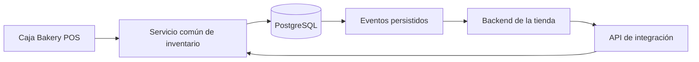

# API de stock y ventas por internet

> Actualización de implementación: la lectura y las reservas transaccionales ya están implementadas en Bakery POS. El contrato vigente es [stock-reservations.md](stock-reservations.md) y OpenAPI 1.1. La retención inicial es de 15 minutos; un pago en curso no vence automáticamente. No se aplica un buffer sin una decisión comercial. Los apartados de este análisis sobre pagos, publicación y entrega siguen siendo propuestas del checkout separado.


Fecha: 20 de octubre de 2026. Estado: entrega 1 implementada en código; entregas posteriores propuestas. Base del análisis: `0058269`. Uso y activación en [inventory-api.md](inventory-api.md).

La API será independiente de la tienda elegida. Bakery POS conservará la autoridad sobre el inventario; una web propia o un adaptador de ecommerce consumirá su contrato. Primero se habilitará la consulta de todo el stock. La recepción de pedidos y las reservas será una segunda entrega, necesaria antes de prometer disponibilidad compartida entre mostrador e internet.

El contrato de la primera entrega está en [stock-api.openapi.json](stock-api.openapi.json). Las rutas de lectura están implementadas y desactivadas por defecto hasta su activación por servidor. La tienda y el checkout vivirán en otro repo y despliegue; sus pagos, compradores y pedidos no se incorporan al POS. Este análisis no verifica saldos ni modifica la configuración de producción.

## Qué existe y qué se puede reutilizar

| Área | Evidencia en el repositorio | Implicación |
| --- | --- | --- |
| Consulta de productos | `server/index.js`, `GET /api/items`; `server/store.js`, `listItems()` y `normalizeItem()` | Ya tenemos ID, SKU, nombre, categoría, unidad, saldo, precio, venta habilitada y fechas. La ruta actual usa la sesión del personal y no constituye una API de integración. |
| Cantidades y precios | Tabla `items`: `NUMERIC(12,2)` para stock y `NUMERIC(12,0)` para precio | Exportar cantidades como decimales exactos y precios como pesos enteros CLP. Validar incrementos según unidad antes de aceptar pedidos. |
| Ventas concurrentes | `createSale()` bloquea productos con `FOR UPDATE`, ordena IDs y usa transacciones | Reutilizar la disciplina de bloqueo y atomicidad. No resolver la concurrencia con una lectura seguida de una escritura sin bloqueo. |
| Reintentos | `checkout_key`, fingerprint y bloqueo por clave; lotes con referencia y comparación del saldo esperado | La integración también necesitará claves y referencias únicas, aisladas por cliente de API. |
| Reservas actuales | `reserveSaleInFile()` y `createSale()` descuentan stock al iniciar un cobro Point pendiente; los fallos/cancelaciones/expiraciones lo restituyen | El campo `quantity` ya es un saldo neto de esas reservas. Restarlas de nuevo produciría un stock incorrecto. |
| Eventos de interfaz | Triggers PostgreSQL envían `bakery_changes`; `server/changes.js` y `/api/events` avisan que algo cambió | Sirven para refrescar pantallas. No guardan un historial reproducible de eventos para una tienda desconectada. |
| Identidad y permisos | `server/auth.js`: cookies de personal, administrador/cajero y límite del cajero a Caja | Crear una identidad técnica distinta. No entregar la contraseña del administrador ni convertir al cajero en cuenta de integración. |
| Caja y contabilidad | `saleActor()` exige sesión; `closureSales()` obtiene ventas por fecha sin filtro de canal; el cierre por sesión usa `register_session_id` | No crear una sesión ficticia para internet. Separar el canal web del arqueo de efectivo y de la conciliación del Point físico. |
| Eliminación | `deleteItem()` elimina el producto y conserva snapshots de ventas con referencias anulables | Una tienda necesita saber cuándo retirar un producto. Las integraciones deberán recibir bajas o reconciliar snapshots completos. |
| SKU | `sku` admite vacío y no tiene unicidad declarada | Usar UUID como identidad principal. Auditar y resolver SKU vacíos/duplicados antes de conectar plataformas que dependan de ellos. |
| Imágenes | `src/productPhotos.js` asigna imágenes por nombre e imports de Vite | No hay aún un catálogo de URLs estables de imágenes en la base. La primera API no debe inventarlas ni depender del bundle del frontend. |

### Dos revisiones obligatorias antes de aceptar pedidos web

1. **Pagos confirmados después de liberar stock.** La actualización actual de estados restituye stock en fallos/cancelaciones/expiraciones, pero no contempla una nueva toma de stock al recibir luego una confirmación pagada con `inventory_applied=false`. La nueva máquina de estados debe resolver este caso y contar con pruebas antes de habilitar otro canal.
2. **Recepción durable de notificaciones.** El webhook Point responde y después procesa mediante `setImmediate`. Si el proceso se reinicia entre ambos pasos, ese trabajo no queda persistido por esta ruta. Para internet, guardar la notificación en una bandeja de entrada antes de confirmarla y procesarla con reintentos. Evaluar la migración del flujo Point por separado, sin cambiar su comportamiento durante la entrega de lectura.

## Entrega 1 Consulta y exportación de todo el stock

API privada entre servidores, bajo `/api/integrations/v1`. Incluye todos los productos vigentes, también los agotados y los que no están habilitados para venta. No incluye ventas, devoluciones, usuarios, cierres, datos de clientes ni secretos.

| Ruta propuesta | Resultado | Permiso |
| --- | --- | --- |
| `GET /api/integrations/v1/inventory` | Snapshot completo y coherente del inventario | `inventory:read` |
| `GET /api/integrations/v1/inventory/{itemId}` | Un producto por su UUID | `inventory:read` |

La consulta completa inicial no tendrá filtros ni paginación: con el catálogo de referencia de 49 productos, una lectura única evita perder productos por saltos de páginas mientras se vende. `count` se calcula sobre los mismos registros enviados, `complete` siempre es `true` y el orden por UUID es estable. Una base vacía devuelve un snapshot válido con cero productos; un fallo de base de datos devuelve un error, nunca un inventario vacío que el consumidor pueda confundir con una baja de todos los productos.

El número 49 procede del catálogo importado del repositorio, no es un límite ni una comprobación del saldo actual en producción. Si el volumen crece, añadir exportaciones materializadas con páginas de un mismo snapshot antes de paginar directamente sobre filas cambiantes. No mantener transacciones abiertas entre solicitudes HTTP.

Ejemplo ilustrativo, sin saldos reales:

```json
{
  "apiVersion": "1",
  "inventoryPoolId": "global",
  "complete": true,
  "count": 1,
  "items": [
    {
      "id": "8f39e7d9-73fd-43aa-8dd1-24a97a3fdc88",
      "sku": "PP-002",
      "name": "ALIADO AMASADO JAMON/QUESO",
      "category": "Bread",
      "unit": "pieces",
      "stockQuantity": "12.00",
      "price": { "amount": 1200, "currency": "CLP" },
      "sellable": true,
      "expiryDate": null,
      "updatedAt": "2026-10-20T17:00:00Z"
    }
  ]
}
```

Reglas del contrato:

- `stockQuantity` refleja el saldo operativo actual, neto de ventas y reservas Point ya aplicadas. No equivale a un conteo físico ni a stock reservado identificado por separado.
- `sellable` refleja la configuración actual del POS. No significa que el producto esté publicado en internet ni garantiza su disponibilidad para una fecha de entrega.
- `inventoryPoolId: global` declara el único inventario compartido que hoy modela el código. Las sucursales de Mercado Pago no constituyen almacenes separados en `items`.
- `id` es la clave estable; el nombre y el SKU son atributos modificables. Un SKU vacío se exporta como `null`, sin omitir el producto.
- Las cantidades son strings con dos decimales y punto; el precio es un entero CLP. No usar separadores de miles ni cantidades formateadas para pantalla.
- Las fechas instantáneas se serializan en UTC. `expiryDate` sigue siendo fecha de calendario, sin convertirla en un instante UTC.
- Mantener categorías y unidades actuales en esta entrega. Normalizar unidades e incrementos mediante una tabla de equivalencias antes de vender, sin deducirlos del nombre del producto.
- La exportación no modifica stock, no crea movimientos y no abre sesiones de caja.

### Actualización eficiente

Reutilizar la compresión HTTP existente. Proponer consultas cada 30 segundos como punto inicial configurable, con espera creciente ante errores. Esta frecuencia es una propuesta, no una garantía de frescura ni una medición de carga.

Emitir un ETag débil calculado sobre la representación canónica del inventario: campos permitidos, cantidades normalizadas y orden estable. No incluir una hora que cambie en cada petición dentro de esa representación. `Date` HTTP informa la hora de la respuesta. Admitir `If-None-Match` y devolver `304` sólo después de verificar credencial, vigencia y permiso.

Conservar `Cache-Control: private, no-store` en la API y variar por `Authorization`. Un consumidor servidor puede recordar explícitamente el ETag y el snapshot importado para su sincronización; no depender de una caché HTTP compartida. La CDN seguirá sirviendo imágenes y recursos estáticos, pero no decidirá disponibilidad ni responderá reservas desde caché.

Un snapshot no es una promesa de compra. Aunque se leyera hace un segundo, el checkout tendrá que validar y reservar otra vez.

## Autenticación y límites

Una credencial por integración y entorno, independiente de las sesiones humanas. Token opaco aleatorio de alta entropía, presentado como `Authorization: Bearer ...`; guardar sólo su hash y un identificador/prefijo no secreto. La emisión inicial y la revocación corresponderán al administrador. La gestión de claves será una operación interna autenticada, fuera de la API pública de inventario.

La primera entrega concede únicamente `inventory:read`. Las capacidades de pedidos y reservas se habilitarán por separado. El permiso se valida en cada ruta y recurso. Una clave de lectura no puede llamar rutas del POS, administrar usuarios o usar otras integraciones. HTTPS, revocación, controles de acceso y límites por consumidor forman parte del diseño; [OWASP recomienda control por endpoint, no exponer claves en URLs y responder 429 ante exceso de solicitudes](https://cheatsheetseries.owasp.org/cheatsheets/REST_Security_Cheat_Sheet.html).

- Montar un router propio con su autenticación antes del middleware de sesiones del personal. No añadir una excepción sin autenticación a `cashierBoundary`.
- Separar credenciales de prueba y producción; mostrar una clave nueva una sola vez, permitir rotación con una ventana de transición y revocación inmediata.
- Límite inicial propuesto de lectura: 60 solicitudes/minuto por integración, más límite de ráfaga e IP. Ajustarlo con mediciones; el contador debe funcionar al escalar a varias réplicas.
- Errores uniformes con código y `requestId`: `400`, `401`, `403`, `404`, `429`, `500` o `503` según el caso. Incluir `Retry-After` cuando corresponda.
- No enviar tokens, cookies, cuerpos completos o datos sensibles a logs. Registrar cliente, ruta, estado, duración e identificador de solicitud.
- Las claves viven en el backend de la futura tienda. CORS no sustituye autenticación y no se abrirá `*` para hacer funcionar una integración desde el navegador.
- La API estará desactivada hasta contar con claves, límites y validación. No crear credenciales, dominios públicos ni conexiones de bases de datos en esta preparación.

## Entrega 2 Pedidos y reservas con stock compartido



### Saldo y reserva

Conservar inicialmente `items.quantity` como saldo neto disponible del sistema actual. Al crear una reserva web activa, descontar una sola vez; al confirmarla, no volver a descontar; al liberarla, restituir una sola vez. El registro de reserva documenta lo que ya se descontó: no se resta otra vez al calcular disponibilidad.

Para publicar en una tienda se añadirá una regla explícita por producto:

`availableToSell = max(0, stockQuantity - onlineSafetyBuffer)`

Esta fórmula se aplica sólo si el producto está habilitado para ese canal, tiene precio válido y satisface las reglas de venta/fecha. El buffer es opcional, por producto y pendiente de decisión; no presupone reservar dos unidades de cada producto. Debe comprobarse otra vez dentro de la transacción de reserva. No se añade un campo `onHand` hasta poder respaldarlo con un modelo real de existencias físicas.

Una reserva de carrito se creará al iniciar el checkout, no al navegar. Su caducidad se coordinará con el proveedor de pago. Como propuesta inicial puede estudiarse una ventana de 15 minutos; el plazo definitivo depende del método de pago. El cobro Point actual tiene su propio vencimiento y no se cambiará automáticamente.

### Operaciones futuras

Estas rutas son propuestas de la segunda entrega y no forman parte del OpenAPI de lectura:

| Operación | Regla principal |
| --- | --- |
| `POST /api/integrations/v1/reservations` | Reserva stock atómicamente con idempotencia y referencia externa única. El pedido comercial completo vive en la tienda. |
| `GET /api/integrations/v1/reservations/{reservationId}` | Recupera el resultado tras un timeout; acceso limitado al cliente propietario. |
| `POST /api/integrations/v1/reservations/{reservationId}/confirm` | Consume la reserva sin descontar otra vez, a solicitud del backend del checkout. |
| `POST /api/integrations/v1/reservations/{reservationId}/release` | Libera una reserva válida una sola vez, tras reconciliar el pago en el checkout. |
| Webhook de pago, en el repo de checkout | Firma verificada, evento persistido y consulta autoritativa. No aceptar afirmaciones del navegador ni reenviar credenciales de pago al POS. |

La referencia externa de pedido debe identificar una única reserva en el POS; no ofrecer dos mecanismos independientes que puedan reservar el mismo carrito dos veces. Los datos del comprador y el pedido completo permanecen en la tienda. No exponer un `PATCH stock` genérico a una tienda para que sobrescriba saldos.

El cliente enviará UUID de producto y cantidad. El servidor determinará precio, moneda, total y reglas de stock. Una cotización previa será orientativa; si cambia el precio, el checkout requerirá una nueva aceptación antes de cobrar. La reserva guardará el precio acordado y no aceptará un total calculado por el cliente como autoridad.

### Concurrencia y reintentos

1. Identificar la integración, validar permisos y buscar la clave de idempotencia con su fingerprint.
2. Comprobar la unicidad de `(integration_id, external_order_id)` y bloquear pedido/reserva según un orden de bloqueos común para todos los flujos.
3. Bloquear todos los productos en orden estable, validar saldo, unidad, incremento, canal, fecha y buffer. [Los bloqueos de fila PostgreSQL impiden escrituras incompatibles hasta finalizar la transacción](https://www.postgresql.org/docs/17/explicit-locking.html).
4. Guardar referencia externa, reserva, saldos, movimientos y eventos de sincronización en la misma transacción; si falta un producto, deshacer todo el carrito.
5. Confirmar y liberar los bloqueos antes de llamar al proveedor de pago o al servidor de la tienda.
6. El backend del checkout crea/reconcilia el pago con una referencia estable. Un timeout externo conserva un estado recuperable; no significa automáticamente que el cobro falló.

La misma clave y el mismo cuerpo recuperan la misma operación. Reutilizar la clave con otro cuerpo devuelve `409`. El mismo pedido externo con una clave distinta tampoco debe generar otra reserva. Las claves y resultados de escrituras no se almacenarán sólo en memoria.

La garantía contra vender la última unidad dos veces requiere que ambos checkouts usen esta autoridad antes de aceptar el pedido. Una tienda que cobra con una copia local y avisa después mediante webhook no ofrece esa garantía. Si una futura plataforma no admite la reserva síncrona requerida, diseñar cupos exclusivos por canal: una sincronización rápida o un buffer sólo reducen el riesgo, no eliminan esa carrera.

### Máquina de estados y pagos tardíos

El checkout gestiona estados orientativos `awaiting_payment`, `payment_unknown`, `paid`, `cancelled`, `expired`, `paid_requires_review` y reembolsos. En el POS, la reserva mantiene estados propios como activa, consumida o liberada para probar cada movimiento, sin copiar toda la máquina de pagos.

- Pago aprobado con reserva activa: consumir la reserva sin un segundo descuento.
- Pago rechazado/cancelado de forma autoritativa: liberar una sola vez.
- Proveedor inaccesible o pago ambiguo al vencer: reconciliar según política; no liberar y asumir que ya no puede aprobarse.
- Pago aprobado después de liberar: intentar una nueva toma de stock de manera atómica. Si no alcanza, registrar `paid_requires_review` y resolver compensación/devolución sin inventar stock ni ocultar un pago recibido.
- Notificación repetida o antigua: verificar estado autoritativo y transiciones válidas; no degradar una venta pagada ni restituir productos nuevamente.
- Devolución de dinero: no implica que el alimento vuelva a ser vendible. Reponer sólo mediante la decisión de inventario correspondiente.

La reconciliación de pagos será persistente y recuperable en el checkout. El POS conserva las reservas y sus transiciones. La política de vencimiento coordinará ambos sistemas sin liberar stock cuyo pago siga ambiguo; no dependerá de una pestaña abierta.

## Sincronización durable

La primera entrega usa snapshots completos. La segunda añadirá una tabla outbox: el cambio de stock y el evento se guardan juntos. Un trabajador reintenta la entrega después del commit. El [patrón transactional outbox](https://docs.aws.amazon.com/prescriptive-guidance/latest/cloud-design-patterns/transactional-outbox.html) aborda el fallo entre escribir la base y notificar otro sistema; admite entregas duplicadas, por lo que el consumidor también debe ser idempotente.

Cada evento llevará `eventId`, producto, versión monotónica por producto, operación y saldo resultante. El receptor ignorará versiones antiguas. Una baja conservará una tombstone para retirar el producto externo aunque ya no exista en `items`.

- Capturar altas, edición de precio/venta/unidad, ajustes, lotes, ventas, reservas, cancelaciones, devoluciones e importaciones. Elegir un mecanismo transaccional que también cubra escrituras de scripts; el trigger actual sólo avisa que cambió alguna tabla.
- `LISTEN/NOTIFY` podrá despertar al trabajador, pero los pendientes se recuperarán de tablas. [NOTIFY comunica a los clientes que están escuchando y entrega notificaciones tras commit](https://www.postgresql.org/docs/17/sql-notify.html); el actual mensaje genérico no es un registro de sincronización.
- Entrega al menos una vez, HMAC sobre bytes originales y fecha/ID, reintentos con espera creciente y jitter, registro de entregas y alerta de pendientes agotados. Guardar secretos de firma cifrados o en un gestor de secretos; un hash irreversible no permite firmar mensajes salientes.
- Persistir el inbox antes de responder al emisor; deduplicar por proveedor, integración e ID de evento. Una respuesta satisfactoria significa recepción durable, no necesariamente procesamiento completo.
- No hacer llamadas de red mientras se mantienen bloqueos de productos. Reservar trabajo mediante leases, ejecutar la llamada fuera de la transacción y confirmar el resultado.
- Reconciliar snapshots completos además de eventos, por ejemplo cada 15 minutos como objetivo inicial configurable. Alertar sobre diferencias y antigüedad; no corregir automáticamente una divergencia cuyo origen no esté claro.
- No diseñar el cursor incremental como `updated_at > última_fecha`, ni asumir que el mayor ID de secuencia equivale a orden de commit. Una transacción tardía o una eliminación puede quedar fuera. Si se añade un feed paginado, su cursor debe recorrer una publicación persistida que no salte commits tardíos; probarlo expresamente.
- Restringir callbacks a destinos HTTPS aprobados. Validar también resolución DNS, redirecciones y direcciones privadas para que el envío de webhooks no permita acceder a servicios internos.

## Separación de ventas online y caja física

La identidad del pedido será una integración técnica con `channel=web`, referencia externa y proveedor de pago. No tendrá `cashier_id` ni `register_session_id` ficticios. La identidad del operador humano seguirá guardándose en las acciones administrativas que lo requieran.

Antes de incorporar ventas web a `sales`, añadir canal y referencias de integración de forma compatible. El esquema actual sólo admite `cash`/`card` y contiene campos específicos del terminal. Diseñar el método/proveedor online sin hacer pasar un Checkout web por una orden Point ni reinterpretar ventas históricas.

El cierre por sesión seguirá limitado a esa sesión. El cierre diario de caja y su PDF deben excluir los pagos web de la conciliación del Point físico y del efectivo. Las métricas de negocio podrán consolidarlos con un filtro de canal y desglose explícito. Hacer este cambio antes de guardar la primera venta online, no después de que afecte a un cierre.

Si se elige Mercado Pago para la web, integrar su checkout online como adaptador en el repo de la tienda. La ruta actual procesa órdenes Point; sus tópicos, IDs y conciliación no se deben reutilizar sin verificar el contrato del producto online. La [documentación de notificaciones de Mercado Pago](https://www.mercadopago.cl/developers/es/docs/links-and-debts/additional-content/your-integrations/notifications/webhooks?scope=prod) distingue recursos de pagos y órdenes y explica la validación `x-signature`. La emisión tributaria y la entrega/retiro son alcances propios del checkout, no de la exportación de inventario.

## Catálogo y futuras tiendas

La API no se ligará a Shopify ni WooCommerce. Se mantendrá una tabla de equivalencias por integración: UUID local, producto/variante externa y, si aplica, ubicación externa. Los cambios de nombre no deben romper esa relación.

Una vez conectada una tienda, la importación del catálogo deberá actualizar por identidad estable. El procedimiento de reemplazar todos los productos y crear otros UUID rompería los vínculos; no ejecutarlo sobre un catálogo conectado sin una migración de equivalencias. Antes de la segunda entrega, favorecer archivado/bajas notificadas frente a borrado no comunicado.

Consideraciones si se elige una plataforma más adelante:

| Destino | Adaptación necesaria |
| --- | --- |
| Web propia | Su backend puede llamar la reserva central antes del pago. Es el flujo principal diseñado aquí. |
| Shopify | Mapear producto/variante, inventory item y location; fijar versión de API y probar compare-and-set, idempotencia y la relación entre stock disponible y comprometido. La [mutación oficial de cantidades](https://shopify.dev/docs/api/admin-graphql/latest/mutations/inventorySetQuantities) está orientada a sistemas que actúan como autoridad del inventario. La documentación consultada presenta variantes de campos CAS: validar el esquema de la versión elegida antes de programar el adaptador. |
| WooCommerce | Mapear producto/variación, manejo de stock y cantidades admitidas; fijar la versión instalada. Sus [webhooks documentan firmas HMAC y eventos de producto/pedido](https://developer.woocommerce.com/docs/apis/rest-api/v2/webhooks). Comprobar la API v3 y los hooks de checkout vigentes al integrar; un webhook posterior al pedido no reserva antes de cobrar. |

No se agregará una segunda base como autoridad del stock ni se aceptarán sobrescrituras de cantidades desde dos sistemas. Una corrección física seguirá siendo una operación administrativa auditable del POS.

## Modelo y orden de ejecución

| Etapa | Cambios previstos | Condición para avanzar |
| --- | --- | --- |
| 0 Preparación de datos | Auditoría de SKU, unidades, incrementos, precios, vencimientos, importaciones y reservas Point abiertas; comprobación de esquema real y recuperación de respaldo | Identidades estables y reglas de saldo acordadas. Es auditoría pendiente, no ejecutada en este análisis. |
| 1 API de lectura | Tabla de clientes/claves, autenticación propia, dos GET del contrato, control de ritmo, logs y feature flag; panel mínimo de claves sólo para administrador | Consumidor de prueba importa el snapshot sin modificar stock y con permisos/revocación verificados. |
| 2 Inventario compartido | Servicio común de inventario, `inventory_reservations`, referencias externas idempotentes; canal contable si se incorpora un resumen de venta externa | Pruebas de última unidad, fallos, pagos tardíos y cierres correctas en PostgreSQL. |
| 3 Tienda conectada, en otro repo | Pedidos, cobros, adaptador de pago, inbox y reconciliación en la tienda; outbox de stock y contrato en el POS | Piloto con pocos productos y comparación de saldos; sin exponer secretos al navegador. |
| 4 Ampliación | Más productos, imágenes estables, CSV o snapshots paginados si hacen falta, reparto/retiro y catálogo por fecha | Métricas de sincronización y operación estables. |

Módulos propuestos: router y autenticación de integraciones separados de `server/auth.js`; consultas/exportación de inventario; servicio de reservas; adaptadores externos; trabajador de sincronización. Evitar añadir toda la lógica a `server/index.js` o ampliar indefinidamente `server/store.js`.

Las migraciones serán aditivas y explícitas, con backfill comprobado antes de exigir nuevas restricciones. Las claves se revocan independientemente de usuarios humanos. La versión por producto y la outbox deben cubrir cualquier escritor de stock, incluidos importadores. No cambiar la semántica de `quantity` con una migración implícita al arrancar.

Para producción compartida se requiere PostgreSQL; la cola del archivo JSON sólo serializa dentro de un proceso y se reservará para pruebas/desarrollo. El arranque de una integración con escrituras debe fallar si esa garantía no está disponible.

No hace falta contratar otro servicio sólo para la lectura inicial: puede ejecutarse en el backend y PostgreSQL actuales. El tráfico, los reintentos y los trabajadores consumirán recursos; medir latencia, conexiones, CPU y cola antes de separar servicios o incorporar Redis u otro broker. No hay estimación monetaria validada en este análisis.

## Pruebas de aceptación para la implementación

La documentación no ejecuta estas pruebas. Son el criterio de terminación del futuro update.

**Lectura:** snapshot completo con productos agotados/no vendibles, cero productos real frente a error de base, SKU nulo, decimales, precios CLP, fechas, orden estable y count correcto; exportación sin cambios en saldos/movimientos. ETag estable sin cambios, cambio al editar un precio/saldo, `304` autorizado y denegación inmediata tras revocar una clave.

**Acceso:** sin token, token malformado, expirado/revocado o de otro entorno; cliente sin scope; clave de lectura intentando escribir o llamar rutas del personal; recursos de otra integración; rate limit compartido y recuperación. Verificar que ni CDN ni logs expongan datos o credenciales.

**Reservas:** dos compradores y una venta de Caja compitiendo por la última unidad; carrito completo con una línea agotada; repetición de la misma clave y referencia con cuerpos iguales/distintos; ingreso por lote, conteo, devolución y reserva concurrentes. Probar transacciones distintas en conexiones/procesos PostgreSQL, no sólo una cola en memoria.

**Pagos y recuperación:** respuesta perdida después de commit, reinicio entre reserva y pago, notificaciones repetidas/fuera de orden, pago ambiguo al vencer, pago aprobado después de liberar, reintentos de devolución y reposición explícita de alimentos. Ningún caso puede duplicar cobro, descuento o restitución.

**Sincronización:** caída tras commit y antes de enviar, caída después de enviar y antes del acuse, trabajador duplicado, callback desconectado, reanudación, evento antiguo, producto borrado y transacción de commit tardío. El consumidor debe converger con el snapshot autoritativo.

**Contabilidad:** venta web fuera de la sesión del cajero y de la conciliación Point; filtros globales por canal; cancelaciones/devoluciones sin alterar cierres históricos guardados; PDFs con totales correctos.

Conservar los gates existentes de build, todas las pruebas y PostgreSQL, sin omitir casos para desplegar. En esta preparación no se ejecutan builds, pruebas de la app ni despliegues.

## Activación y recuperación

Activar primero lectura en pruebas y después una credencial de producción de sólo lectura. No habilitar pedidos con el mismo cambio. Acordar el umbral de frescura visible y la frecuencia de reconciliación antes del piloto.

Para activar escrituras: migraciones completas, reglas de fecha/precio, separación de caja y prueba de concurrencia aprobadas. Desplegar con recepción de pedidos desactivada; observar stock y activar un piloto limitado. Preparar indicadores de última sincronización, reservas activas/ambiguas, errores de pago, reintentos, divergencias y ventas por canal.

Ante una incidencia, bloquear pedidos nuevos sin borrar reservas, pagos, claves de idempotencia ni eventos pendientes. Continuar la reconciliación de pagos/reservas existentes. Revocar la clave o detener una integración concreta si hace falta, conservando Caja. Una reversión de código no debe perder operaciones creadas con la versión nueva; probar compatibilidad de recuperación antes de activar el canal.

## Decisiones pendientes para el futuro update

Las [recomendaciones para resolver estas decisiones](decisiones-api-stock-online.md) detallan una opción inicial para cada punto y los datos que conviene validar antes de activar ventas. Se mantienen como propuestas.

- Cómo será el checkout independiente, qué proveedor de pago usará y quién administrará su backend.
- Si se venderá sólo lo disponible hoy o también por encargo/fecha futura. El segundo caso requiere capacidad/stock por fecha; el inventario global actual no lo representa.
- Qué productos publicar, unidades e incrementos permitidos, precios web y política de vencimiento/retiro/reparto.
- Plazo de reserva, tratamiento de pagos asíncronos y margen de seguridad por producto.
- Reglas para reposición tras devoluciones y tratamiento contable/tributario de las ventas web.

La decisión ya acordada es mantener una API independiente. Las demás decisiones no bloquean el diseño de lectura, pero sí deben cerrarse antes de habilitar ventas reales por internet.
